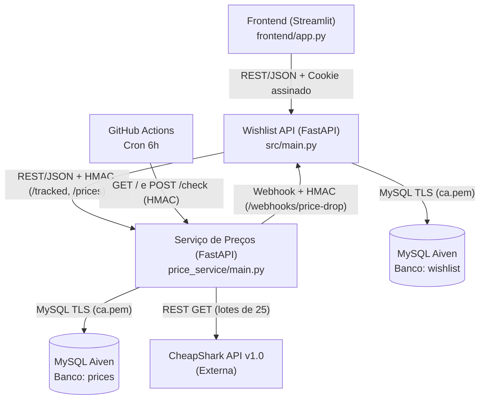

# Relatório Técnico de Arquitetura e Integrações — Sistema de Wishlist de Jogos (AV3)

**Disciplina:** Técnicas de Integração de Sistemas (AV3)  
**Equipe:** Victor Lins Gurgel do Amaral · Lorenzo Barros Calheiros Pinheiro · Gabriel De Sousa Nobre  
**Repositório:** `https://github.com/gabrieldsn2006/sistema_de_wishlist` (branch `main`, commit `5e1ab7a`)

---

## 1. Visão Geral da Arquitetura

O **Sistema de Wishlist de Jogos** evoluiu da AV2 (API REST monolítica com 2FA por SMS) para uma **arquitetura distribuída baseada em serviços** (AV3). O usuário cria sua lista de desejos, consulta o menor preço atual e histórico dos jogos (em dólar, USD) e recebe alertas automáticos quando algum preço cai.

A solução integra **dois sistemas de API próprios** — a **Wishlist API** (`src/`) e o **Serviço de Preços** (`price_service/`) — à API externa pública **CheapShark**, ao agendador **GitHub Actions** e ao frontend **Streamlit** (`frontend/`).

| Sistema / Componente | Pasta | Papel na Arquitetura |
|---|---|---|
| **Wishlist API** | [`src/`](../src/) | Usuários, sessão em cookie assinado, papéis (`admin`/`user`), catálogo, wishlists e alertas |
| **Serviço de Preços** | [`price_service/`](../price_service/) | Rastreamento na CheapShark, histórico temporal, checagem em lote e envio de webhooks |
| **Frontend Web** | [`frontend/`](../frontend/) | Interface em Streamlit; atua apenas como cliente HTTP da Wishlist API |
| **CheapShark API** | Externa | Preços atuais, descontos e menor preço histórico em lojas de PC (USD) |
| **GitHub Actions** | [`.github/workflows/check-prices.yml`](../.github/workflows/check-prices.yml) | Agendador externo que acorda os serviços e dispara `POST /check` a cada 6 horas |

---

## 2. Por que Dois Serviços (`Wishlist API` e `Serviço de Preços`)?

Em vez de embutir o monitoramento de preços na API da AV2, a equipe separou o sistema em duas APIs independentes por motivos técnicos concretos verificados no código:

- **Responsabilidades e domínios distintos:** a **Wishlist API** (`src/`) cuida do domínio centrado no usuário (identidade, autenticação, papéis `admin`/`user`, catálogo e wishlists). O **Serviço de Preços** (`price_service/`) cuida de coleta externa, séries temporais (`price_history`), execução em lote e entrega de eventos (`webhook_outbox`), sem conhecer usuários nem cookies.
- **Reaproveitamento da AV2 sem reescrita:** a base existente da AV2 permaneceu intacta, recebendo apenas o cliente HTTP [`src/price_client.py`](../src/price_client.py) e o receptor de alertas [`src/routers/alerts.py`](../src/routers/alerts.py).
- **Isolamento de falhas e degradação controlada:** instabilidades na CheapShark ou a hibernação do Serviço de Preços no Render gratuito **não derrubam o login nem a wishlist**. Em `src/price_client.py`, falhas retornam `None` (`PriceServiceUnavailable`) e o endpoint `GET /wishlist` ([`src/routers/wishlist.py`](../src/routers/wishlist.py)) devolve `price_status` (`"ok"`, `"not_tracked"` ou `"unavailable"`), além de reagendar automaticamente via `BackgroundTasks` jogos ainda não monitorados (*self-healing*).
- **Bancos separados (*Database per Service*):** embora usem a mesma instância MySQL na Aiven por economia, cada serviço possui seu próprio banco (`DB_NAME=wishlist` e `DB_NAME=prices`) e scripts independentes, sem `JOIN` entre domínios. No Render, sobem em 3 Web Services com `requirements.txt` enxutos e isolados.

| Critério | Monólito (Tudo em `src/`) | Dois Serviços (Arquitetura Adotada) |
|---|---|---|
| **Impacto de falha externa** | Erro ou lentidão na CheapShark pode travar rotas do usuário | Falha isolada; wishlist segue operando (`price_status: "unavailable"`) |
| **Persistência** | Tabelas acopladas no mesmo banco | Bancos separados (`wishlist` e `prices`); comunicação via HTTP |
| **Deploy e reuso** | Dependências misturadas; difícil reutilizar o monitor | Deploys independentes no Render; Serviço de Preços reutilizável |

---

## 3. Uso Independente e Comercialização do Serviço de Preços

Por ter sido projetado sem nenhuma dependência de `users`, `wishlist` ou sessão de login, o `price_service/` já opera como um **componente autônomo** (*standalone*). Seu contrato genérico recebe apenas pares `{game_id, title}` em `POST /tracked`, expõe preços e histórico em `GET /prices` e `GET /prices/{game_id}/history`, e notifica quedas de preço via webhook para a URL configurada em `WISHLIST_API_URL` assinada com `INTERNAL_SECRET`.

### Exemplos de Uso Independente (Sem a Wishlist API)

1. **Bot de Promoções (Discord / Telegram / WhatsApp):** um servidor de bot cadastra os jogos mais populares via `POST /tracked` e configura sua própria rota como destino do webhook. A cada `POST /check`, sempre que um jogo cair de preço, o bot publica automaticamente no canal o preço antigo, o preço novo, a loja e o link `deal_url`.
2. **Portal Editorial / Blog Gamer ou Extensão de Navegador:** um site de análises consome `GET /prices?game_ids=...` e `GET /prices/{game_id}/history` para exibir o menor preço histórico (`cheapest_ever`), a loja mais barata atual e o gráfico de variação de preços diretamente na página de cada jogo.
3. **Monitoramento Competitivo para Lojistas:** uma loja digital acompanha o histórico de preços de títulos concorrentes para ajustar campanhas promocionais automaticamente.

### Como Vender como Serviço Separado (API-as-a-Service / SaaS B2D)

Para comercializar o `price_service/` como um produto independente voltado a desenvolvedores e empresas:

- **Adaptação arquitetural mínima:** introduzir suporte *multi-tenant* com uma tabela de clientes assinantes (`api_key` / `client_id`, `webhook_url` própria, `signing_secret` HMAC por cliente e cota máxima de jogos monitorados).
- **Proposta de valor:** quem contrata evita implementar limites de lote da CheapShark (25 IDs), tratamento de `HTTP 429`, cache de lojas, armazenamento de histórico temporal e entrega confiável de webhooks com *Outbox* e idempotência.
- **Modelo de monetização em camadas:**

| Plano | Limite de Jogos | Frequência de Checagem | Histórico e Recursos |
|---|---|---|---|
| **Free** | Até 25 jogos | A cada 12 horas | Histórico de 30 dias e webhook padrão |
| **Pro** | Até 500 jogos | A cada 1 hora | Histórico completo, webhooks prioritários e retry estendido |
| **Enterprise** | Ilimitado | Sob demanda / SLA | Múltiplas fontes de preço e conversão USD → BRL |

---

## 4. REST/JSON da Wishlist API para o Serviço de Preços

A comunicação de saída da Wishlist API (`src/price_client.py`) utiliza **REST/JSON síncrono** porque responde a demandas imediatas da interface:

- **Consulta em lote sob demanda (`GET /prices?game_ids=1,2,3`):** quando o usuário abre `GET /wishlist`, o preço precisa ser exibido na hora. Buscar todos os IDs em uma única requisição evita o antipadrão **$N+1$ chamadas HTTP** (com `TIMEOUT = 10s`).
- **Sincronização assíncrona via `BackgroundTasks`:** em `POST /wishlist`, `DELETE /wishlist/{id}`, `PUT /games/{id}` e `DELETE /games/{id}`, a Wishlist API responde imediatamente ao usuário e dispara `POST /tracked` ou `DELETE /tracked/{game_id}` em segundo plano. A API só remove um jogo do monitoramento se `controllers.game_is_wished` confirmar que nenhum outro usuário o deseja, e re-rastreia automaticamente se o administrador alterar o título do jogo.
- **Simplicidade e testabilidade:** ambos os serviços usam FastAPI + Pydantic (validação estrita devolvendo `HTTP 422`), facilitando testes no Swagger (`/docs`) e no Postman.

---

## 5. Webhook do Serviço de Preços para a Wishlist API (e Por que não Mensageria)

No sentido inverso (`Serviço de Preços → Wishlist API`), a escolha foi um **Webhook orientado a eventos** (`POST /webhooks/price-drop`):

- **Adequação ao evento:** a queda de preço nasce no Serviço de Preços durante o `/check` e ocorre poucas vezes. A alternativa seria a Wishlist API fazer *polling* frequente perguntando *"baixou?"*, desperdiçando requisições. Com o webhook, a notificação só é emitida quando `new_price <= old_price - 0.01`, demonstrando dois padrões complementares no projeto (requisição-resposta em um sentido e orientado a eventos no outro).
- **Por que não mensageria (RabbitMQ / Kafka):** um *broker* adicionaria um terceiro serviço para hospedar e manter; além disso, o Render gratuito coloca serviços para dormir e não executa processos consumidores contínuos em segundo plano. Para o baixo volume de checagens diárias, **Webhook + Outbox + Idempotência** garante confiabilidade equivalente sem infraestrutura extra (caso um *broker* fosse exigido futuramente, o CloudAMQP possui plano gratuito).
- **Entrega confiável e idempotente ([`price_service/notifier.py`](../price_service/notifier.py) e [`src/models.py`](../src/models.py)):** todo evento é persistido antes na tabela `webhook_outbox`; no `flush`, o serviço desperta a Wishlist API (`GET /`, timeout de 90 s) e envia com até 10 tentativas. O `event_id` determinístico (`{game_id}-{storeID}-{new_price:.2f}-{YYYYMMDD}`) somado à `UniqueConstraint("user_id", "event_id", name="uq_alert_user_event")` em `alerts` garante que reenvios nunca gerem alertas duplicados.

---

## 6. CheapShark como Sistema Externo

A **CheapShark API v1.0** foi escolhida por ser **gratuita, dispensar cadastro ou chave de API** e consolidar ofertas de várias lojas de PC (Steam, GOG, Green Man Gaming, GameBillet, etc.), retornando já prontos o preço atual, o preço normal, o percentual de desconto e o menor preço histórico (`cheapestPriceEver`).

| Critério | CheapShark (Escolhida) | Steam Store API | IsThereAnyDeal | RAWG API |
|---|---|---|---|---|
| **Chave / Cadastro** | Não exige | Sem endpoint oficial de preços | Exige aprovação/API key | Exige API key |
| **Cobertura** | Múltiplas lojas PC | Apenas Steam | Múltiplas lojas PC | Metadados (sem preços) |
| **Menor Histórico** | Nativo (`cheapestPriceEver`) | Não fornece | Fornece | Não fornece |
| **Consultas em Lote** | Até 25 `gameID`s (`?ids=`) | Não otimizado | Sim | Não aplicável |

- **Limitações aceitas e mitigadas em [`price_service/cheapshark.py`](../price_service/cheapshark.py):** preços exclusivamente em dólar (`currency = "USD"`), obrigatoriedade de `User-Agent` descritivo (`WishlistAV3/1.0`), *rate limit* (`HTTP 429` tratado pela exceção `RateLimited`), máximo de 25 IDs por consulta (`BATCH_SIZE = 25`), limite de `RESOLVE_PER_CHECK = 10` buscas novas por rodada, cache em memória de `/stores` e uso do link oficial `https://www.cheapshark.com/redirect?dealID=...`. Como só o Serviço de Preços fala com ela via padrão *Adapter*, trocar de fornecedor no futuro não afeta a Wishlist API.

---

## 7. GitHub Actions como Agendador — Justificativa, Custo e Escala

O workflow [`.github/workflows/check-prices.yml`](../.github/workflows/check-prices.yml) atua apenas como um disparador externo agendado (`cron: "0 */6 * * *"` e `workflow_dispatch`), acordando ambos os serviços no Render (`GET /`) e chamando `POST /check` com assinatura HMAC. Foi escolhido porque o plano gratuito do Render hiberna serviços após 15 minutos (matando agendadores em memória) e o Cron Job nativo do Render é pago.

Sobre o questionamento levantado acerca de **custo e escalabilidade com o aumento de jobs**:

1. **Custo em repositórios públicos e privados:** em **repositórios públicos** (como este projeto), os runners padrão do GitHub Actions (`ubuntu-latest`) são **totalmente gratuitos e possuem minutos ilimitados** (*unmetered*), não havendo cobrança por quantidade de execuções. Mesmo em repositórios privados, o plano gratuito inclui **2.000 minutos/mês**; 4 execuções diárias de ~1–2 min consomem cerca de 120–240 min/mês (~10% da cota).
2. **O número de jobs não cresce com o número de usuários ou jogos:** aumentar a base de usuários ou o catálogo monitorado **não cria novos jobs no GitHub Actions**. Continua existindo **apenas 1 único job agendado** chamando `POST /check`, enquanto o crescimento de jogos é absorvido internamente em lotes de 25 IDs na CheapShark.
3. **Limitações reais de escala (análise crítica):** onde a ressalva do professor procede é em um cenário comercial privado de alta frequência ou SLA rígido: o GitHub Actions limita a **concorrência simultânea** (20 jobs no plano Free, 40 no Pro, 60 no Team), o `cron` pode sofrer atrasos de vários minutos sob carga do GitHub, workflows agendados são desativados após 60 dias sem commits e repositórios privados comerciais pagam por minuto excedente. Como o acoplamento é mínimo (apenas uma chamada HTTP assinada a `POST /check`), migrar o gatilho para **AWS EventBridge**, **Cloud Scheduler** ou **Render Cron Job** exige **zero alteração no código** dos dois serviços.

---

## 8. Segurança das Integrações e Estado Atual

- **Autenticação de usuários (sem OAuth2 nem Bearer Token):** senhas com **Argon2** (`pwdlib`), sessão *stateless* em cookie assinado (`itsdangerous`, `HttpOnly`, `SameSite=Lax`, `Secure`, validade de 8h), revogação global via `session_version` e RBAC (`admin` e `user`). Na AV3, o 2FA por SMS da AV2 foi removido ([`migrations/003_remove_otp.sql`](../migrations/003_remove_otp.sql)) pelas limitações do Twilio *trial* (40 envios e números pré-verificados), mantendo `stage: "active"` em [`src/security.py`](../src/security.py) para invalidar cookies pendentes antigos; o login via GitHub OAuth também não foi incorporado para cumprir integralmente a proibição de OAuth2.
- **Autenticação entre serviços (HMAC-SHA256):** [`src/signing.py`](../src/signing.py) e [`price_service/signing.py`](../price_service/signing.py) assinam `timestamp\nMÉTODO\ncaminho?query\ncorpo` com `INTERNAL_SECRET` nos headers `X-Timestamp` (janela anti-*replay* de 300 s) e `X-Signature: sha256=<hex>`, comparados via `hmac.compare_digest`. Todo tráfego externo usa HTTPS no Render e TLS com `ca.pem` no MySQL da Aiven.
- **Estado atual (`commit 5e1ab7a`):** toda a arquitetura distribuída — rotas dos dois serviços, `price_client.py`, `notifier.py` com *outbox*, webhook idempotente em `alerts.py`, assinatura HMAC, frontend Streamlit atualizado e workflow do GitHub Actions — já está implementada e integrada; resta apenas concluir as três funções marcadas com `TODO` em [`price_service/cheapshark.py`](../price_service/cheapshark.py) (`search_game`, `get_games` e `store_name`) e versionar os testes automatizados no repositório.

**Conclusão:** A separação entre `Wishlist API` e `Serviço de Preços` atende integralmente aos objetivos da AV3 com fronteiras arquiteturais reais, garantindo isolamento de falhas externas, independência de dados e reuso comercial do monitor de preços, aliando comunicação síncrona (REST) e orientada a eventos (Webhook + Outbox) com segurança por HMAC-SHA256 e deploy contínuo gratuito.
