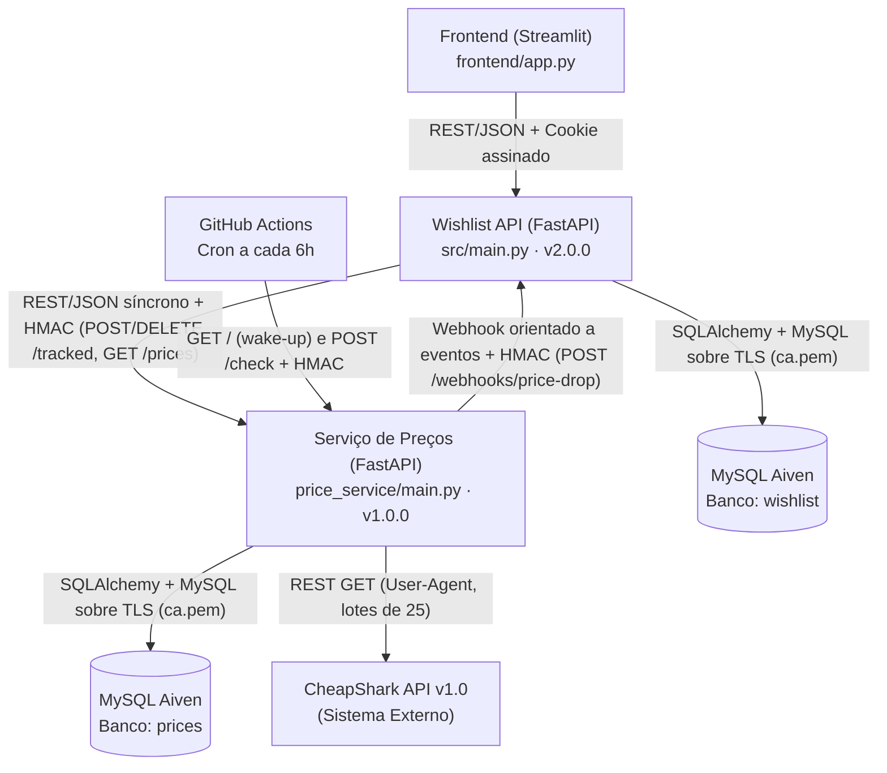
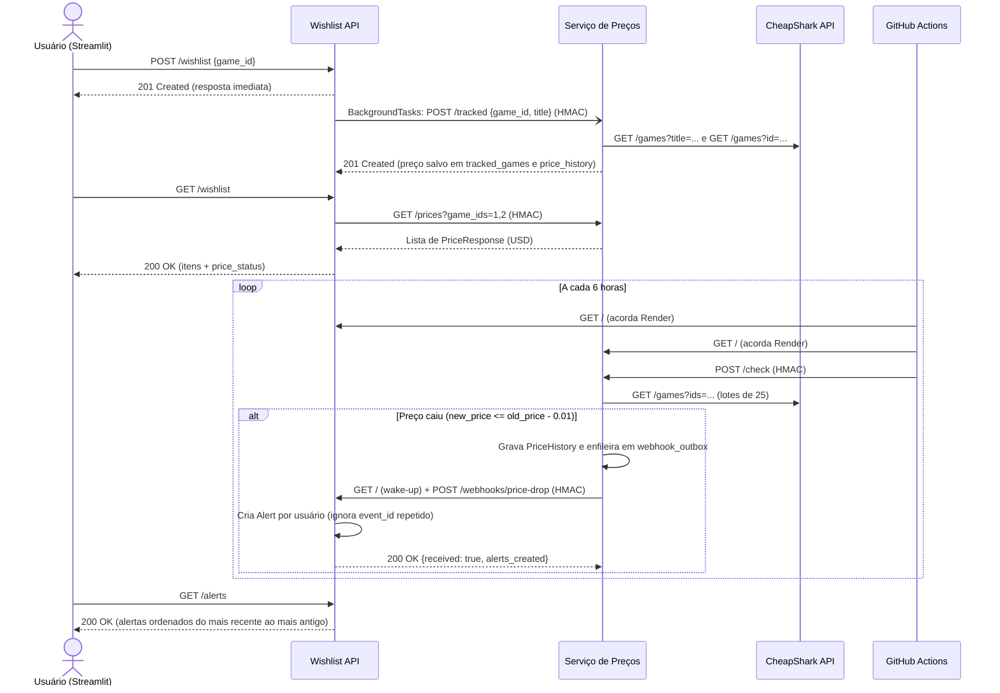

# Relatório Técnico de Arquitetura e Decisões de Integração — Sistema de Wishlist de Jogos (AV3)

**Disciplina:** Técnicas de Integração de Sistemas (AV3)  
**Equipe:**
- Victor Lins Gurgel do Amaral
- Lorenzo Barros Calheiros Pinheiro
- Gabriel De Sousa Nobre

**Repositório:** `https://github.com/gabrieldsn2006/sistema_de_wishlist` (análise baseada no commit `5e1ab7a`, branch `main`)

---

## 1. Introdução e Visão Geral

O **Sistema de Wishlist de Jogos** evoluiu de uma API REST monolítica com verificação em duas etapas por SMS (AV2) para uma **arquitetura distribuída orientada a serviços** (AV3). O sistema permite que usuários criem contas, montem listas de desejos de jogos a partir de um catálogo gerenciado por administradores, visualizem preços atualizados em lojas de PC (em dólar, USD), acompanhem o menor preço histórico e recebam alertas automáticos sempre que algum jogo da sua lista sofre queda de preço.

Para atender aos requisitos de integração entre múltiplos sistemas próprios e externos com segurança, resiliência e deploy independente, a solução foi estruturada em **dois sistemas de API próprios e desacoplados** — a **Wishlist API** (`src/`) e o **Serviço de Preços** (`price_service/`) — apoiados por uma interface web em **Streamlit** (`frontend/`), pela API externa **CheapShark** e por um agendador automatizado via **GitHub Actions** (`.github/workflows/check-prices.yml`).

### Componentes do Ecossistema

| Componente | Localização no Repositório | Natureza | Responsabilidade Principal |
|---|---|---|---|
| **Wishlist API** | [`src/`](../src/) | Sistema próprio (FastAPI) | Usuários, autenticação por cookie assinado, autorização por papéis (`admin`/`user`), catálogo de jogos, wishlists e caixa de alertas |
| **Serviço de Preços** | [`price_service/`](../price_service/) | Sistema próprio (FastAPI) | Rastreamento de jogos na CheapShark, histórico temporal de preços, verificação em lote (`POST /check`) e entrega de eventos via *outbox* + webhook |
| **Frontend Web** | [`frontend/`](../frontend/) | Cliente HTTP (Streamlit) | Interface gráfica por papel (`user` e `admin`); consome exclusivamente a Wishlist API mantendo cookie de sessão por usuário |
| **CheapShark API** | Externa (`apidocs.cheapshark.com`) | API REST pública | Consulta de títulos de jogos de PC, ofertas em múltiplas lojas (Steam, GOG, GameBillet, etc.) e menor preço histórico em USD |
| **GitHub Actions** | [`.github/workflows/check-prices.yml`](../.github/workflows/check-prices.yml) | Agendador (*Cron*) | Desperta os serviços no Render a cada 6 horas e dispara `POST /check` assinado com HMAC-SHA256 |

### Diagrama de Arquitetura



---

## 2. Justificativa Central: Por que Separar em Dois Sistemas de API?

Em vez de adicionar os módulos de consulta à CheapShark, histórico de preços e agendamento diretamente dentro da Wishlist API original (mantendo um monólito), optou-se explicitamente por extrair toda a lógica de monitoramento de mercado para um segundo serviço independente (`price_service/`). Essa decisão fundamenta-se em **seis pilares técnicos** observáveis diretamente na implementação do repositório.

### 2.1. Separação de Responsabilidades (*Bounded Contexts* e Coesão)

Os dois sistemas pertencem a domínios de negócio distintos com ritmos de mudança diferentes:

- **Domínio centrado no usuário (`src/` — Wishlist API):** gerencia identidade, credenciais Argon2, cookies de sessão, papéis (`admin` e `user`), catálogo curado de jogos (`games`), associação usuário–jogo (`wishlist`) e entrega visual de alertas ao usuário final (`alerts`). Suas rotas respondem a ações humanas interativas.
- **Domínio operacional de preços (`price_service/` — Serviço de Preços):** não conhece usuários, senhas, cookies ou permissões. Sua única responsabilidade é manter um catálogo espelho de jogos monitorados (`tracked_games`), traduzi-los para identificadores externos (`cheapshark_id`, `steam_app_id`), registrar séries temporais de variação de preço (`price_history`) e detectar quedas de preço para emitir eventos (`webhook_outbox`).

### 2.2. Isolamento de Falhas e Degradação Controlada (*Graceful Degradation*)

Integrações com APIs externas públicas estão sujeitas a latência variável, indisponibilidade temporária e limites de taxa (*rate limit* `HTTP 429`). Ao isolar o acesso à CheapShark em um serviço separado e proteger o cliente interno em [`src/price_client.py`](../src/price_client.py), nenhuma falha de preço derruba as operações centrais do usuário:

- Se o Serviço de Preços estiver dormindo no plano gratuito do Render ou fora do ar, `price_client._request` captura `requests.RequestException` e lança `PriceServiceUnavailable`. Em `price_client.get_prices`, o retorno `None` sinaliza indisponibilidade sem lançar erro HTTP `500` na Wishlist API.
- Na rota `GET /wishlist` ([`src/routers/wishlist.py`](../src/routers/wishlist.py)), o campo `price_status` informa de maneira explícita o estado de cada item:
  - `"ok"`: preço obtido do Serviço de Preços;
  - `"not_tracked"`: o jogo ainda não consta no Serviço de Preços (por exemplo, estava indisponível no momento do cadastro na wishlist);
  - `"unavailable"`: Serviço de Preços temporariamente inacessível.
- A interface Streamlit ([`frontend/app.py`](../frontend/app.py)) traduz esses estados de forma amigável para o usuário, mantendo login, catálogo, adição e remoção da wishlist 100% funcionais mesmo quando preços estão indisponíveis.
- Adicionalmente, o `GET /wishlist` implementa **autocura (*self-healing*)**: ao detectar `price_status == "not_tracked"`, agenda automaticamente em segundo plano (`BackgroundTasks`) uma nova chamada `price_client.track(item.game_id, item.game.title)`.
- Da mesma forma, `POST /wishlist`, `DELETE /wishlist/{id}`, `PUT /games/{id}` e `DELETE /games/{id}` disparam `price_client.track` e `price_client.untrack` via `BackgroundTasks` após enviar a resposta HTTP ao cliente, garantindo baixa latência para o usuário final.

### 2.3. Isolamento de Dados (*Database per Service*)

Embora ambos os serviços compartilhem a mesma instância gerenciada de MySQL na Aiven (por restrição de custo no plano gratuito), eles operam sobre **bancos de dados logicamente isolados** (`DB_NAME=wishlist` em [`src/database.py`](../src/database.py) e `DB_NAME=prices` em [`price_service/database.py`](../price_service/database.py)):

- Um serviço **nunca** acessa ou faz `JOIN` nas tabelas do outro. Toda troca de informação ocorre exclusivamente via contratos HTTP/JSON validados por Pydantic.
- Cada serviço evolui seu próprio esquema e scripts de migração de forma independente ([`migrations/`](../migrations/) na Wishlist API e [`price_service/migrations.sql`](../price_service/migrations.sql) no Serviço de Preços).
- Ambos oferecem suporte independente à variável `DATABASE_URL` (ex.: `sqlite:///dev.db`), permitindo testar cada serviço isoladamente em ambiente local sem depender do MySQL remoto.

### 2.4. Camada Anticorrupção e Desacoplamento da API Externa (Padrão *Adapter*)

Toda a semântica específica da CheapShark — URL base `https://www.cheapshark.com/api/1.0`, identificador `gameID`, `dealID`, `storeID`, lotes máximos de 25 IDs (`BATCH_SIZE = 25`), obrigatoriedade de `User-Agent` customizado e tratamento de `HTTP 429` (`RateLimited`) — fica confinada a um único módulo: [`price_service/cheapshark.py`](../price_service/cheapshark.py).

- A Wishlist API nunca manipula `cheapshark_id`, `deal_id` ou `store_id`; ela recebe apenas objetos normalizados (`PriceInfo` e `PriceDropEvent`).
- Caso a equipe decida substituir a CheapShark por outro provedor (ex.: IsThereAnyDeal ou Steam Store API), nenhuma linha de `src/` ou `frontend/` precisa ser modificada.
- Como evidência prática desse desacoplamento no estado atual do repositório (`5e1ab7a`), as funções `search_game`, `get_games` e `store_name` de `price_service/cheapshark.py` ainda contêm marcações `TODO` (lançando `CheapSharkError` / retornando `"Loja <id>"`), mas todo o restante dos dois serviços, contratos HMAC, *outbox*, webhook e frontend já compila, inicia e interage normalmente sem falhas em cascata (`found: false`).

### 2.5. Perfis de Carga, Ciclo de Vida e Deploy Independentes

Os dois sistemas apresentam perfis operacionais opostos:

- **Wishlist API (`src/`):** tráfego interativo e síncrono guiado por requisições do usuário (login, leitura do catálogo, gestão de wishlist e alertas).
- **Serviço de Preços (`price_service/`):** tráfego periódico em lote (`POST /check` acionado a cada 6 horas pelo GitHub Actions), tolerante a latências maiores (`--max-time 240` no workflow e processamento em lotes de 25 jogos) e capaz de acordar sob demanda quando necessário.

No Render, cada componente possui um Web Service independente no mesmo repositório, diferenciados apenas pelo `Root Directory` (`""`, `price_service` e `frontend`), com seus próprios `requirements.txt` e variáveis de ambiente isoladas. Dessa forma, o Serviço de Preços sequer precisa instalar bibliotecas de hash de senha (`pwdlib[argon2]`) ou assinatura de cookies (`itsdangerous`), mantendo sua superfície de dependências enxuta.

### 2.6. Alinhamento Genuíno aos Requisitos da Disciplina (AV3)

A proposta da AV3 exige dois sistemas próprios conversando entre si e integrados a pelo menos um sistema externo, com autenticação, consistência de dados e deploy acessível. A separação entre `Wishlist API` e `Serviço de Preços` cria uma fronteira arquitetural real — e não artificial —, justificando o uso combinado de REST síncrono, Webhook assíncrono, assinatura HMAC-SHA256 e padrão *Outbox* com idempotência.

### Comparativo: Arquitetura Monolítica vs. Dois Serviços

| Critério | Monólito (Tudo na Wishlist API) | Arquitetura em Dois Serviços (Adotada) |
|---|---|---|
| **Acoplamento de domínio** | Regras de usuário, wishlist, histórico de preços e parsing da CheapShark misturados no mesmo código | Domínio de usuário isolado em `src/` e monitoramento de preços isolado em `price_service/` |
| **Impacto de falhas da CheapShark** | Exceções ou lentidão na consulta externa podem degradar rotas críticas ou travar workers da API principal | Falhas ficam contidas no Serviço de Preços; a wishlist degrada suavemente (`price_status: "unavailable"`) |
| **Banco de dados** | Todas as tabelas misturadas no mesmo schema, facilitando consultas acopladas por `JOIN` | Bancos separados (`wishlist` e `prices`), comunicação estrita via API REST/Webhook |
| **Dependências e Deploy** | Um único deploy carrega dependências de autenticação, ORM e scraping/preços juntos | 3 Web Services independentes no Render com `requirements.txt` e `.env` específicos |
| **Reuso e Substituição** | Trocar provedor de preços ou reutilizar o monitor em outro projeto exige refatoração ampla | O Serviço de Preços funciona como provedor reutilizável e encapsula a CheapShark via Adapter |

---

## 3. Padrões de Comunicação e Fluxos de Integração

### 3.1. Por que REST Síncrono em um Sentido e Webhook no Outro?

A comunicação entre os dois sistemas próprios combina dois padrões complementares:

1. **REST/JSON Síncrono (`Wishlist API → Serviço de Preços`):**
   - `GET /prices?game_ids=1,2,3`: ao abrir a wishlist (`GET /wishlist`), o usuário precisa visualizar os preços imediatamente. A consulta em lote (*batch*) via query string evita o antipadrão **N+1 requisições HTTP**, trazendo os preços de todos os jogos da lista em uma única chamada (com `TIMEOUT = 10s` configurável via `PRICE_SERVICE_TIMEOUT`).
   - `POST /tracked` e `DELETE /tracked/{game_id}`: sincronizam o conjunto de jogos monitorados conforme os usuários adicionam/removem itens da wishlist ou quando o administrador edita/remove jogos do catálogo.
2. **Webhook Orientado a Eventos (`Serviço de Preços → Wishlist API`):**
   - `POST /webhooks/price-drop`: uma queda de preço é um **evento raro e assíncrono** cuja origem é o Serviço de Preços durante a varredura periódica (`POST /check`). Em vez de a Wishlist API realizar *polling* constante perguntando se houve redução de preço, o Serviço de Preços notifica a Wishlist API apenas quando `new_price <= old_price - 0.01`.

### 3.2. Por que Webhook + Outbox em vez de Mensageria (RabbitMQ / Kafka)?

Embora filas de mensagens (RabbitMQ, Kafka ou SQS) sejam uma alternativa clássica para comunicação orientada a eventos, elas foram descartadas por razões práticas de infraestrutura e custo:

- Exigiriam provisionar, pagar ou manter um *broker* adicional fora do Render.
- O plano gratuito do Render coloca Web Services em hibernação após 15 minutos de inatividade e não suporta processos consumidores em segundo plano contínuos sem custo adicional.
- O volume de eventos de queda de preço no contexto acadêmico é baixo, e o padrão **Webhook + Tabela Outbox (`webhook_outbox`) + Idempotência (`event_id`)** entrega as mesmas garantias de confiabilidade (*at-least-once delivery* sem duplicação de efeito) usando apenas o MySQL já disponível.

### 3.3. Fluxo Principal e Ciclo de Vida Integrado



Além do fluxo principal acima, a sincronização entre os dois bancos contempla regras explícitas de ciclo de vida:

- **Remoção da wishlist (`DELETE /wishlist/{id}`):** após excluir o item, a Wishlist API verifica `controllers.game_is_wished(db, removed.game_id)`. Somente se **nenhum outro usuário** ainda desejar aquele jogo, ela chama `price_client.untrack(removed.game_id)` (`DELETE /tracked/{game_id}`) em segundo plano, evitando cancelar o monitoramento de jogos compartilhados por vários usuários.
- **Edição de jogo pelo admin (`PUT /games/{id}`):** se o campo `title` for alterado e o jogo estiver na wishlist de alguém, a Wishlist API chama `price_client.track(updated.id, updated.title)`. No Serviço de Preços, `track_game` detecta `game.title != data.title`, limpa os campos vinculados anteriormente (`cheapshark_id`, `steam_app_id`, `current_price`, etc.) e refaz a busca na CheapShark para o novo título.
- **Exclusão de jogo pelo admin (`DELETE /games/{id}`):** remove o jogo (em cascata com wishlists e alertas locais) e dispara `price_client.untrack(id)` em segundo plano.

---

## 4. Consistência, Confiabilidade e Resiliência

### 4.1. Padrão *Transactional Outbox* (`webhook_outbox`)

Em [`price_service/notifier.py`](../price_service/notifier.py), nenhum evento de queda de preço é enviado diretamente em memória com risco de perda se a Wishlist API estiver hibernando ou indisponível:

1. **Persistência prévia (`notifier.enqueue`):** antes de tentar qualquer chamada HTTP, o evento é serializado em JSON e gravado na tabela `webhook_outbox` com `delivered_at = NULL` e `attempts = 0`.
2. **Despertar sob demanda (`_wake_wishlist_api`):** antes de enviar eventos pendentes, `notifier.flush` envia um `GET /` para a Wishlist API com `WAKE_TIMEOUT = 90` segundos para suportar o tempo de *cold start* do Render gratuito.
3. **Entrega resiliente (`_send` e `flush`):** envia os avisos pendentes com `SEND_TIMEOUT = 15` segundos (até `MAX_ATTEMPTS = 10` tentativas). Em caso de sucesso, preenche `delivered_at`; em caso de erro de resposta HTTP, registra `last_error` (truncado em 255 caracteres). Se ocorrer falha de conexão (`Falha de conexão`), o laço é interrompido imediatamente (`break`) preservando os demais avisos para o próximo `/check`.

### 4.2. Idempotência Ponta a Ponta

Como retentativas de webhook e reexecuções de agendamento podem enviar o mesmo aviso mais de uma vez, a idempotência foi garantida em três camadas:

- **Identificador determinístico do evento:** em [`price_service/main.py`](../price_service/main.py), `apply_details` gera:
  ```python
  "event_id": f"{game.game_id}-{deal['storeID']}-{new_price:.2f}-{now:%Y%m%d}"
  ```
  Assim, a mesma queda de preço na mesma loja e no mesmo dia produz sempre o mesmo `event_id`.
- **Unicidade no produtor (`webhook_outbox`):** a coluna `event_id` possui restrição `unique=True` e `notifier.enqueue` ignora eventos já enfileirados.
- **Unicidade no consumidor (`alerts`):** em [`src/models.py`](../src/models.py), a tabela `alerts` define `UniqueConstraint("user_id", "event_id", name="uq_alert_user_event")`, e `controllers.create_alerts` verifica previamente se `(user_id, event_id)` já existe antes de inserir.
- **Idempotência no monitoramento (`POST /tracked`):** chamar `POST /tracked` repetidamente para o mesmo `game_id` e título não duplica registros (retorna `200 OK` se já existir, em vez de `201 Created`).

### 4.3. Validação Estrita de Contratos (Pydantic)

Todos os dados de entrada e saída nos dois serviços — incluindo o payload do webhook (`PriceDropEvent`), respostas de preço (`PriceResponse`, `PriceInfo`, `WishlistItemWithPrice`) e parâmetros de consulta (`game_ids` validado por regex `^\d+(,\d+)*$`) — são validados automaticamente via Pydantic (`src/schemas.py` e `price_service/schemas.py`), devolvendo `HTTP 422` diante de qualquer violação de contrato.

---

## 5. Segurança, Autenticação e Autorização

O sistema adota **dois mecanismos distintos de segurança**, adequados à natureza de cada fronteira (usuário humano vs. serviço automatizado), respeitando integralmente o requisito da disciplina de **não utilizar OAuth2 nem Bearer Token**.

### 5.1. Autenticação e Autorização de Usuários (Cliente → Wishlist API)

Implementada em [`src/security.py`](../src/security.py) e [`src/routers/auth.py`](../src/routers/auth.py):

- **Armazenamento de senhas:** hash **Argon2** via `pwdlib` (`PasswordHash.recommended()`), com migração transparente de senhas legadas em texto puro durante o primeiro login (`verify_password`).
- **Sessão *stateless* por cookie assinado:** após `POST /auth/login`, a API grava o cookie `session` usando `URLSafeTimedSerializer` (`itsdangerous`) contendo `{"uid": user.id, "sv": user.session_version, "stage": "active"}`, assinado com `SECRET_KEY` e validade de 8 horas (`SESSION_MAX_AGE = 28800`). O cookie é configurado com as flags `HttpOnly` (bloqueia leitura via JavaScript contra XSS), `SameSite=Lax` (mitiga CSRF) e `Secure` (habilitado por padrão em produção via HTTPS; configurável com `COOKIE_SECURE=false` apenas para desenvolvimento em `http://localhost`).
- **Revogação global sem estado de sessão:** o campo `session_version` na tabela `users` é incrementado em `POST /auth/logout-all` e na troca de senha (`controllers.update_user`), invalidando imediatamente todos os cookies emitidos anteriormente.
- **Controle de acesso por papéis (RBAC):** os papéis `admin` e `user` são aplicados por injeção de dependência (`require_admin`, `require_user`, `get_current_user`). Todo cadastro público (`POST /users`) cria exclusivamente `role = "user"` (o corpo `UserCreate` não aceita `role`), um administrador não pode alterar o próprio papel (`PATCH /users/{id}/role` retorna `400`), e consultas/remoções de itens da wishlist ou alertas de outros usuários retornam `404` para não vazar a existência de registros alheios.

### 5.2. Evolução da Autenticação da AV2 para a AV3 (Remoção do SMS)

Na AV2, o login contava com um segundo fator por código SMS via **Twilio Verify** (etapa intermediária `STAGE_PENDING` no cookie e rota `POST /auth/verify`). Na AV3 (commit `5e1ab7a`), o SMS foi removido (`src/sms.py` e `src/twilio.py` excluídos; [`migrations/003_remove_otp.sql`](../migrations/003_remove_otp.sql) disponibilizada para remoção opcional das colunas `otp_hash`, `otp_expires_at` e `otp_attempts`) pelos seguintes motivos técnicos e práticos:

- A conta gratuita (*Trial*) do Twilio possuía teto rígido de 40 verificações e restringia o envio apenas a até 5 números previamente validados no painel administrativo, impedindo que novos usuários ou avaliadores testassem a aplicação livremente.
- O campo `stage: "active"` foi preservado intencionalmente dentro do payload do cookie em `src/security.py` para continuar rejeitando com `401` quaisquer cookies `"pending"` antigos emitidos antes da atualização.
- Embora um login via GitHub OAuth tenha sido avaliado como proposta inicial para substituir o SMS, ele não foi incorporado ao código final para manter estrita aderência à restrição da disciplina contra OAuth2 e Bearer Tokens.

### 5.3. Autenticação entre Serviços (HMAC-SHA256)

Para proteger as rotas internas do Serviço de Preços (`POST /tracked`, `DELETE /tracked/{game_id}`, `GET /prices*`, `POST /check`) e o webhook da Wishlist API (`POST /webhooks/price-drop`) sem recorrer a Bearer Tokens, ambos os serviços implementam o mesmo módulo de assinatura criptográfica em [`src/signing.py`](../src/signing.py) e [`price_service/signing.py`](../price_service/signing.py).

> **Decisão de engenharia:** os dois arquivos `signing.py` são mantidos idênticos de propósito porque cada serviço possui raiz e deploy próprios no Render, impedindo importações cruzadas de módulos Python em tempo de execução sem criar um pacote compartilhado externo.

**Protocolo da assinatura:**
1. O emissor concatena a string canônica:
   ```text
   <X-Timestamp>\n<MÉTODO_HTTP_MAIÚSCULO>\n<caminho?query_string>\n<corpo_bruto_em_bytes>
   ```
2. Calcula o `HMAC-SHA256` utilizando o segredo compartilhado `INTERNAL_SECRET` e envia os cabeçalhos:
   - `X-Timestamp`: timestamp Unix atual em segundos.
   - `X-Signature`: `sha256=<digest_hexadecimal>`.
3. O receptor (`verify_signature`) verifica:
   - Presença e formato dos cabeçalhos;
   - Janela temporal contra ataques de *replay* (`abs(time.time() - int(timestamp)) <= 300`, tolerância máxima de 5 minutos);
   - Igualdade criptográfica em tempo constante via `hmac.compare_digest(expected, signature)` (prevenindo *timing attacks*). Qualquer divergência responde `HTTP 401`.

### 5.4. Segurança em Transporte

Todo o tráfego externo e entre serviços no Render ocorre sobre **HTTPS**, e todas as conexões de banco de dados entre os dois serviços FastAPI e o MySQL na Aiven utilizam **TLS** com validação explícita do certificado da autoridade certificadora (`ca.pem` e `price_service/ca.pem`).

---

## 6. Integração Externa (CheapShark) e Estratégias de Mitigação

A escolha da **CheapShark API v1.0** para alimentar o Serviço de Preços decorreu da análise comparativa entre as opções disponíveis para preços de jogos de PC:

| Critério | CheapShark (Escolhida) | Steam Store API | IsThereAnyDeal (ITAD) | RAWG API |
|---|---|---|---|---|
| **Custo e Chave de API** | Gratuita e sem chave (*no API key*) | Pública, mas sem endpoint oficial consolidado de ofertas | Exige aprovação/chave de API | Exige chave de API |
| **Cobertura de Lojas** | Múltiplas lojas de PC (Steam, GOG, Green Man Gaming, GameBillet, etc.) | Apenas loja Steam | Múltiplas lojas | Catálogo/metadados apenas |
| **Menor Preço Histórico** | Nativo (`cheapestPriceEver` em `/games?id=`) | Não fornece | Fornece | Não fornece preços |
| **Consultas em Lote** | Sim, até 25 `gameID`s por requisição (`?ids=...`) | Não otimizado para lote de preços multi-loja | Sim | Não aplicável |

### Restrições Conhecidas da CheapShark e Mitigações no Projeto

1. **Moeda única em Dólar (USD):** a API retorna preços exclusivamente em dólar (`"14.99"`). O projeto explicita `currency = "USD"` nos modelos (`Alert`, `PriceResponse`, `PriceInfo`, `PriceDropEvent`) e exibe `US$` na interface Streamlit, evitando ambiguidades de conversão imprecisa.
2. **Header `User-Agent` obrigatório:** a CheapShark rejeita `User-Agent` genérico da biblioteca `requests`. O módulo `price_service/cheapshark.py` envia o cabeçalho configurável `CHEAPSHARK_USER_AGENT` (padrão `WishlistAV3/1.0`).
3. **Limitação de taxa (*Rate Limit* `HTTP 429`):**
   - `POST /check` utiliza consultas em lote de no máximo **25 jogos** (`BATCH_SIZE = 25`), reduzindo drasticamente o número de requisições HTTP.
   - Jogos ainda não mapeados (`cheapshark_id IS NULL`) têm sua busca limitada a `RESOLVE_PER_CHECK = 10` por execução.
   - Ao receber `HTTP 429`, `cheapshark.py` lança a exceção específica `RateLimited`, interrompendo o laço de buscas da rodada sem derrubar o restante da entrega do *outbox*.
   - As lojas (`/stores`) devem ser cacheadas em memória para evitar chamadas repetidas apenas para resolver `storeID` → nome da loja.
4. **Regra de redirecionamento de ofertas:** seguindo os termos de uso da CheapShark, os links clicáveis entregues aos usuários usam `https://www.cheapshark.com/redirect?dealID={deal_id}` (`cheapshark.deal_url`).

---

## 7. Infraestrutura, Agendamento e Frontend

### 7.1. Por que GitHub Actions como Agendador (`.github/workflows/check-prices.yml`)?

No plano gratuito do Render, um Web Service hiberna após 15 minutos sem tráfego, o que interromperia qualquer agendador em memória (como APScheduler ou tarefas `asyncio` em segundo plano). Por outro lado, o recurso nativo de **Cron Jobs do Render é pago**. A solução adotada utiliza um workflow agendado no **GitHub Actions**:

- Executa gratuitamente a cada **6 horas** (`cron: "0 */6 * * *"`) e permite execução manual sob demanda via `workflow_dispatch` (recurso essencial para demonstrações em sala).
- Primeiro executa duas chamadas paralelas de *wake-up* (`GET /` com `--max-time 120 --retry 3 --retry-all-errors`) para acordar tanto o `PRICE_SERVICE_URL` quanto o `WISHLIST_API_URL`.
- Em seguida, gera os cabeçalhos `X-Timestamp` e `X-Signature` usando `openssl dgst -sha256 -hmac "$INTERNAL_SECRET"` diretamente no runner Ubuntu e chama `POST $PRICE_SERVICE_URL/check` com timeout de 240 segundos.

### 7.2. Configuração dos Web Services no Render

| Configuração | Wishlist API | Serviço de Preços | Frontend |
|---|---|---|---|
| **Root Directory** | *(vazio — raiz do repo)* | `price_service` | `frontend` |
| **Build Command** | `pip install -r requirements.txt` | `pip install -r requirements.txt` | `pip install -r requirements.txt` |
| **Start Command** | `cd src && uvicorn main:app --host 0.0.0.0 --port $PORT` | `uvicorn main:app --host 0.0.0.0 --port $PORT` | `streamlit run app.py --server.port $PORT --server.address 0.0.0.0` |
| **Principais Env Vars** | `DB_*`, `DB_NAME=wishlist`, `SECRET_KEY`, `INTERNAL_SECRET`, `PRICE_SERVICE_URL` | `DB_*`, `DB_NAME=prices`, `INTERNAL_SECRET`, `WISHLIST_API_URL`, `CHEAPSHARK_USER_AGENT` | `API_URL` |

### 7.3. Frontend Desacoplado (`frontend/app.py`)

O frontend em Streamlit atua estritamente como **cliente HTTP externo**: ele não importa módulos de `src/` nem acessa bancos de dados ou o Serviço de Preços. Cada sessão de usuário no Streamlit mantém sua própria instância de `requests.Session()` (`st.session_state.http`), preservando o cookie assinado da Wishlist API e exibindo telas específicas conforme o papel (`user`: Catálogo, Minha wishlist com preços/descontos/histórico, Alertas; `admin`: Catálogo, Gerenciar jogos, Usuários).

---

## 8. Modelagem de Dados e Contratos de API

### 8.1. Bancos de Dados Separados (MySQL na Aiven)

**Banco `wishlist` (`src/models.py`):**

| Tabela | Função | Principais Colunas e Restrições |
|---|---|---|
| `users` | Contas de usuários e RBAC | `id`, `username`, `email` (único), `password` (Argon2), `phone` (opcional), `role` (`user`/`admin`), `session_version` |
| `games` | Catálogo curado de jogos | `id`, `title`, `genre`, `platform`, `release_date` |
| `wishlist` | Relação usuário ↔ jogo | `id`, `user_id` (FK `users.id`), `game_id` (FK `games.id`) |
| `alerts` | Alertas recebidos via webhook | `id`, `user_id` (FK), `game_id` (FK), `event_id` (`UniqueConstraint(user_id, event_id)`), `old_price`, `new_price`, `normal_price`, `store`, `deal_url`, `currency` (`USD`), `created_at` |

**Banco `prices` (`price_service/models.py`):**

| Tabela | Função | Principais Colunas e Restrições |
|---|---|---|
| `tracked_games` | Jogos monitorados (espelho por `game_id`) | `game_id` (PK sem autoincrement), `title`, `cheapshark_id`, `steam_app_id`, `cheapshark_title`, `current_price`, `normal_price`, `store_id`, `deal_id`, `cheapest_ever`, `last_checked_at` |
| `price_history` | Série temporal de variações de preço | `id`, `game_id` (FK `tracked_games.game_id` com `ON DELETE CASCADE`), `price`, `normal_price`, `store_id`, `checked_at` |
| `webhook_outbox` | Fila persistente de entrega confiável | `id`, `event_id` (único), `payload` (JSON), `attempts`, `last_error`, `created_at`, `delivered_at` |

### 8.2. Resumo dos Contratos de Endpoints

**Wishlist API (`src/routers/`):**
- **Auth (`/auth`):** `POST /auth/login` (Público), `GET /auth/me` (Logado), `POST /auth/logout` (Público), `POST /auth/logout-all` (Logado).
- **Users (`/users`):** `POST /users` (Público), `GET /users` (Admin), `GET /users/{id}` (Próprio ou Admin), `PUT /users/{id}` (Próprio), `PATCH /users/{id}/role` (Admin), `DELETE /users/{id}` (Próprio ou Admin).
- **Games (`/games`):** `POST /games` (Admin), `GET /games` (Público), `GET /games/{id}` (Público), `PUT /games/{id}` (Admin), `DELETE /games/{id}` (Admin).
- **Wishlist (`/wishlist`):** `POST /wishlist`, `GET /wishlist` (enriquecido com `price` e `price_status`), `GET /wishlist/{id}`, `DELETE /wishlist/{id}` (todos restritos a `User`).
- **Alertas & Webhook:** `GET /alerts` (User), `DELETE /alerts/{id}` (User), `POST /webhooks/price-drop` (Assinatura HMAC).

**Serviço de Preços (`price_service/main.py`):**
- `GET /` (Público — health check / wake-up).
- `POST /tracked`, `DELETE /tracked/{game_id}`, `GET /prices?game_ids=...`, `GET /prices/{game_id}`, `GET /prices/{game_id}/history`, `POST /check` (todos protegidos por assinatura HMAC).

**Exemplo de payload JSON do webhook `POST /webhooks/price-drop`:**
```json
{
  "event_id": "1-23-14.96-20261125",
  "game_id": 1,
  "title": "Red Dead Redemption 2",
  "old_price": 59.99,
  "new_price": 14.96,
  "normal_price": 59.99,
  "savings_percent": 75.1,
  "store": "GameBillet",
  "deal_url": "https://www.cheapshark.com/redirect?dealID=...",
  "currency": "USD",
  "detected_at": "2026-11-25T20:39:14"
}
```

---

## 9. Estado Atual da Implementação, Limitações e Próximos Passos

### Estado Atual (Commit `5e1ab7a`)

A inspeção do código-fonte confirma que toda a **espinha dorsal distribuída da AV3 já está implementada e integrada**:
- Os dois serviços FastAPI (`src/` e `price_service/`), o cliente REST (`src/price_client.py`), a assinatura HMAC (`signing.py` em ambos), o *outbox* (`price_service/notifier.py`), o receptor de webhook idempotente (`src/routers/alerts.py`), a remoção do SMS (`migrations/003_remove_otp.sql`), o frontend atualizado (`frontend/app.py`) e o workflow do GitHub Actions (`.github/workflows/check-prices.yml`) estão implementados.
- Resta concluir a implementação das três funções marcadas com `TODO` em [`price_service/cheapshark.py`](../price_service/cheapshark.py) (`search_game`, `get_games` em lotes de 25 e `store_name` com cache em memória), além de versionar no repositório os testes automatizados correspondentes.

### Limitações Conhecidas e Evoluções Futuras

1. **Cold start no Render gratuito:** serviços hibernam após 15 minutos sem uso, levando até ~1 minuto para responder à primeira requisição; mitigado pelo *wake-up* no workflow do GitHub Actions e em `_wake_wishlist_api`, além de mensagens informativas na UI.
2. **Preços exclusivamente em USD:** dependente da moeda nativa da CheapShark; evolução futura pode integrar uma API de câmbio (com cache diário) para exibição opcional em BRL.
3. **Migrações manuais via SQL:** o projeto utiliza scripts em `migrations/` e `price_service/migrations.sql`; a adoção do **Alembic** automatizaria evoluções de schema.
4. **Rate limit no login por senha:** atualmente a validação de credenciais em `POST /auth/login` não possui bloqueio progressivo contra força bruta.
5. **Inatividade de workflows agendados no GitHub:** o GitHub desativa automaticamente gatilhos `schedule` caso o repositório fique 60 dias sem commits.
6. **Cobertura de testes no repositório:** adicionar testes automatizados (ex.: `pytest` com `DATABASE_URL=sqlite:///:memory:` e *mocks* HTTP para CheapShark e chamadas entre serviços) diretamente no repositório e integrá-los ao CI.
